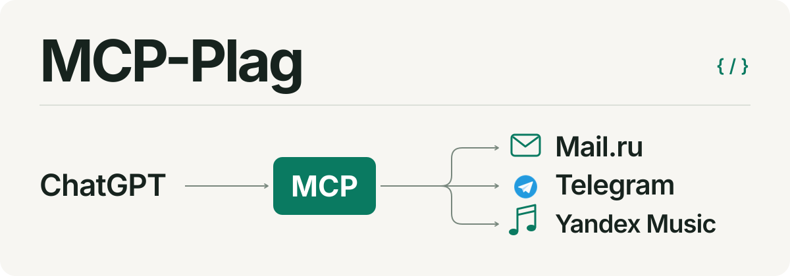

<p align="center">
  
</p>

<p align="center">
  <strong>Русский</strong> · <a href="README.en.md">English</a> · <a href="README.zh-CN.md">简体中文</a> · <a href="README.ja.md">日本語</a> · <a href="README.de.md">Deutsch</a>
</p>

# MCP-Plag

**Почта, музыка и Telegram в ChatGPT — с исходниками для своего сервера.**

Коллекция плагинов для ChatGPT и их MCP-серверов: готовые пакеты, код, иконки, инструкции и проверки. Здесь собраны три интеграции — Mail.ru, Яндекс Музыка и Telegram.

## Выберите интеграцию

| Интеграция | Что можно делать | Исходники и пакеты |
| --- | --- | --- |
| **Mail / Mail.ru** | Искать и читать письма, работать с черновиками, вложениями и папками | [Обзор](Mail.ru/README.md) · [Архивы](Mail.ru/releases/) |
| **Яндекс Музыка** | Искать музыку, получать рекомендации и управлять своими плейлистами | [Обзор](Yandex.Music/README.md) · [Архивы](Yandex.Music/releases/) |
| **@tg / Telegram** | Читать и искать сообщения, выбирать именованный аккаунт; первый реальный вход ещё проверяется | [Обзор](Telegram/README.md) · [Архивы](Telegram/releases/) · [Статус](Telegram/STATUS.md) |

### Mail: от письма к готовому черновику

> «Найди письмо о встрече, покажи переписку и сохрани ответ всем как черновик».

**Mail 1.0.0 · MCP 0.4.0 · 31 команда.** Поддерживаются ящики `mail.ru`, `inbox.ru`, `list.ru`, `bk.ru` и `internet.ru`. Можно читать до 20 писем за запрос, отвечать и пересылать с вложениями, архивировать письма, менять статус прочтения и работать с папками.

Ответ и пересылка по умолчанию создают черновик. Отправка выполняется по явному запросу; окончательное удаление и очистка корзины тоже требуют отдельного запроса. [Возможности и ограничения Mail →](Mail.ru/README.md)

### Яндекс Музыка: от поиска к плейлисту

> «Найди треки этого исполнителя и добавь выбранные в мой плейлист».

**Плагин 1.0.3 · 14 музыкальных команд · серверный снимок от 25 октября 2026 года.** Поиск по каталогу, треки исполнителей и альбомов, чарты, понравившиеся композиции, история прослушиваний, «Моя волна» и похожие треки. Можно создавать приватные плейлисты, добавлять до 100 треков за вызов и удалять собственные плейлисты по явному запросу.

Это частная установка с одним серверным аккаунтом. Потоковое воспроизведение и скачивание аудио не предусмотрены. [Возможности и настройка Яндекс Музыки →](Yandex.Music/README.md)

### @tg: несколько Telegram-аккаунтов

**App 1.0.2 · MCP 0.1.0.** Реализованы QR/2FA-вход, названия аккаунтов, переименование и явный выбор отправителя. Сервер развёрнут на VDSina; первый реальный вход владельца ожидает снятия ограничения my.telegram.org. Прошли 923 теста и проверки пакетов; реальные команды и оставшиеся слоты иконок проверяются после входа. [Возможности и состояние @tg →](Telegram/README.md)

## Запустите на своём сервере

Связка работает так: **ChatGPT → MCP-сервер → выбранный сервис**. Пакет плагина связывает ChatGPT с зарегистрированным приложением, а сервер выполняет операции с почтой, музыкой или Telegram.

1. Откройте обзор нужной интеграции и скачайте пакет плагина и серверный архив.
2. Разверните сервер, установите зависимости и настройте HTTPS и закрытую конфигурацию по его инструкции.
3. Зарегистрируйте собственное приложение с HTTPS endpoint вашего сервера и замените привязку приложения в пакете плагина.

Идентификаторы в опубликованных пакетах относятся к установке автора. Копирование ZIP само по себе не создаёт отдельную интеграцию. Текущие серверы размещены на **VDSina**; для самостоятельного развёртывания можно использовать другой VPS/VDS или свою машину с доступным HTTPS-адресом. Для Яндекс Музыки также сохранён режим подключения через SSH.

[Развёртывание Mail](Mail.ru/server/README.md) · [Развёртывание Яндекс Музыки](Yandex.Music/server/README.md) · [Развёртывание @tg](Telegram/server/README.md)

## Данные и границы доступа

- **Секреты задаются отдельно.** Рабочие пароли, токены, ключи, базы и логи не входят в публикуемые пакеты.
- **Mail подключается через пароль приложения.** Вход выполняется через HTTPS-страницу; пароль не нужно передавать в чат. Сервер поддерживает отдельные подключения и хранит пароли в зашифрованном виде с помощью Fernet.
- **Яндекс Музыка использует аккаунт сервера.** OAuth-доступ ограничен его владельцем; эта конфигурация не предоставляет отдельные музыкальные аккаунты разным пользователям.
- **Сервер участвует в обработке данных.** Результаты запрошенных действий, включая письма и вложения, передаются в ChatGPT через MCP. Администратор выбранного сервера управляет конфигурацией, базой и ключами.

Ограничения вложений Mail, условия авторизации и проверки описаны в руководствах интеграций. Mail рассчитан на небольшую частную установку; перед широким использованием проверяйте нужные сценарии на тестовом аккаунте.

## Что лежит в репозитории

```text
Mail.ru/           Плагин Mail, MCP-сервер, тесты и ZIP
Yandex.Music/      Плагин Яндекс Музыки, MCP-сервер и ZIP
Telegram/          Плагин @tg, MCP-сервер, иконки, тесты и ZIP
assets/readme/     Редактируемая SVG-схема
README*.md        Описания на пяти языках
```

Из корня репозитория можно пересобрать архивы и проверить их содержимое и контрольные суммы:

```sh
python Mail.ru/tools/build_releases.py
python Mail.ru/tools/verify_package.py
python Yandex.Music/tools/build_releases.py
python Yandex.Music/tools/verify_package.py
python Telegram/tools/build_releases.py
python Telegram/tools/verify_package.py
```

Подробные инструкции по тестированию и сведения о версиях находятся в каталогах интеграций. Сборка архивов не требует обращения к реальной почте или изменения музыкальных плейлистов.
